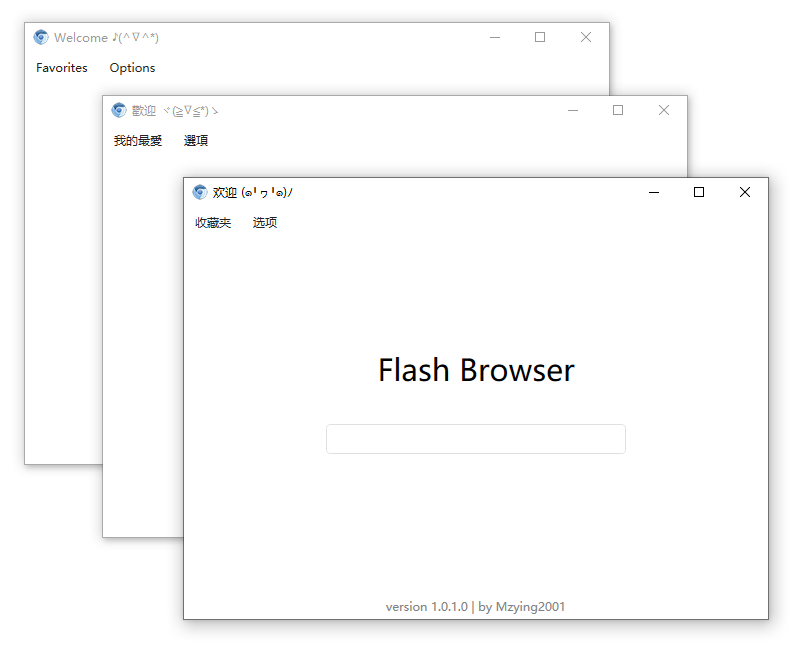
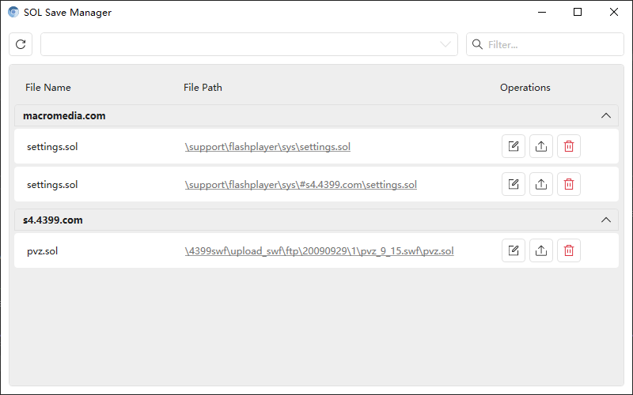
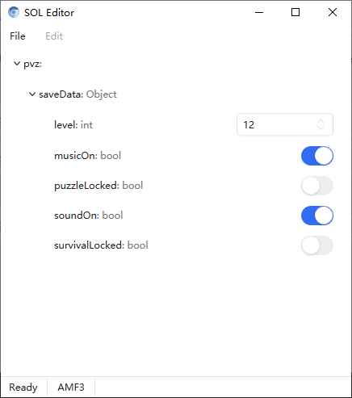
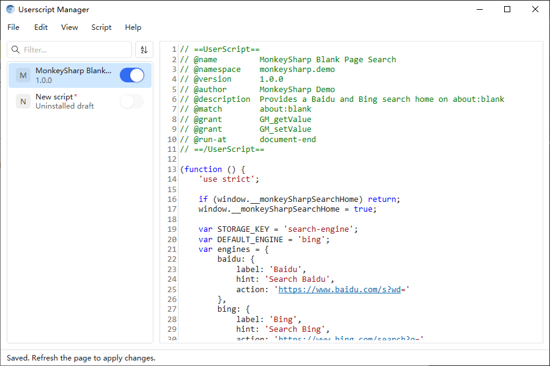

<h1 align="center">
    
     
    CefFlashBrowser
     
    
    
    
</h1>

**中文** | [English](./README.en.md)

## 软件介绍

CefFlashBrowser 是一个自带 Flash Player 插件的浏览器，可以正常显示网页上的 Flash 内容，此外还支持打开本地 SWF 文件，管理 Flash 游戏存档等。

## 下载与使用

在 [Release](https://github.com/Mzying2001/CefFlashBrowser/releases/latest) 下载最新的软件压缩包，解压后双击 `CefFlashBrowser.exe` 即可使用。

> [!NOTE]
> 软件运行依赖 `.NET Framework 4.6.2`，若运行时提示应用程序无法启动，前往[这里](https://dotnet.microsoft.com/zh-cn/download/dotnet-framework/net462)下载安装即可运行。

## 存档管理

使用**SOL存档管理器**，可以对游戏存档进行导出、导入、修改等操作。

> [!TIP]
> 建议在修改存档之前先对存档文件进行备份，以防数据丢失。

## 用户脚本

CefFlashBrowser 会在符合匹配规则的网页上自动运行已启用的用户脚本，让你自定义网页内容和行为。在网页上点击 `.user.js` 链接即可打开安装确认窗口。也可以在主窗口的 **选项 → 管理用户脚本** 中选择本地文件或输入 URL 来安装脚本，并编辑脚本、切换启用状态或检查更新。

## 参与贡献

欢迎反馈问题、提出功能建议或提交改动。请参阅[贡献指南](./CONTRIBUTING.md)。

## Star 趋势

<a href="https://star-history.dera.page/Mzying2001/CefFlashBrowser?style=github">
 <picture>
   <source media="(prefers-color-scheme: dark)" srcset="https://star-history.dera.page/svg?repos=Mzying2001/CefFlashBrowser&theme=dark&style=github" />
   <source media="(prefers-color-scheme: light)" srcset="https://star-history.dera.page/svg?repos=Mzying2001/CefFlashBrowser&style=github" />
   
 </picture>
</a>
